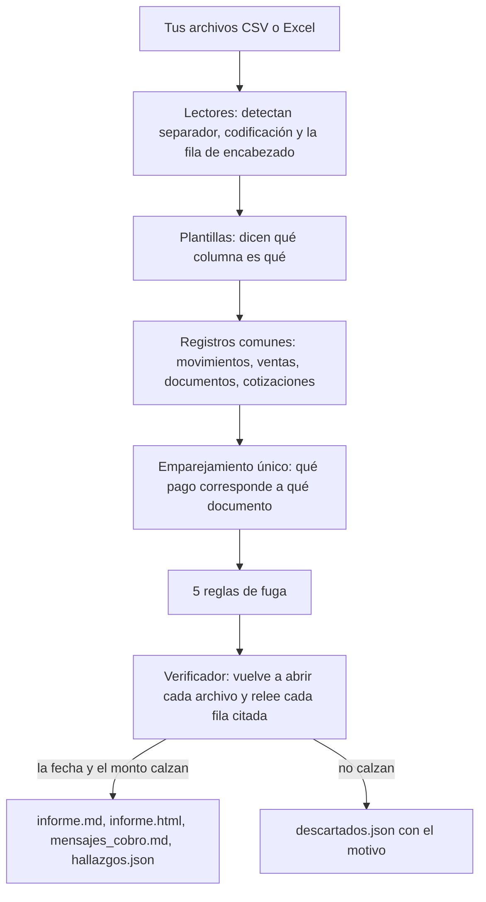

# Detective de Fugas Pyme

Encuentra la plata que tu pyme pierde sin darse cuenta: trabajos aceptados que nadie facturó, facturas que no te pagaron, plata que entró sin boleta, software que pagas de más e IVA mal calculado.
Lee los archivos que ya puedes descargar de tu banco, de tu máquina de tarjetas y del SII, y te entrega un informe con cada fuga, su monto y la fila exacta del archivo que la prueba.
Funciona en tu computador, sin claves ni cuentas, y tus archivos no salen de ahí.

**La plata que se pierde no hace ruido: hay que contarla fila por fila.**

> **Antes de confiar en un resultado:** todos los datos de ejemplo son 100% ficticios y el detector todavía no se ha probado con archivos reales de bancos. Con tus archivos, revisa cada hallazgo contra la fila que cita y con tu contador antes de cobrar o emitir algo. Este proyecto no reemplaza a tu contador.

**¿No programas?** No necesitas la terminal: usa la página web, que hace lo mismo con dos clics. Dirección: https://detective-fugas-web.vercel.app (los pasos están en "Cómo usar la web").

## Resultado en la demo

El repositorio trae dos empresas inventadas con 12 fugas escondidas cada una y una llave de respuestas que el detector nunca lee. Un programa aparte (`scripts/evaluar.py`) compara lo que encontró el detector con la llave. Esto prueba que el detector encuentra lo que se escondió en datos inventados; no prueba que funcione igual con tu banco.

| Demo | Formatos | Fugas encontradas | Fugas inventadas (falsos positivos) | Plata en juego |
|---|---|---|---|---|
| A (`data/demo`) | Banco con columnas Cargos y Abonos, Mercado Pago, cotizaciones en Excel | 12 de 12 | 0 | $3.738.472 |
| B (`data/demo_b`) | Otro banco con un solo monto con signo, Transbank, presupuestos solo con neto | 12 de 12 | 0 | $3.817.410 |

La demo B usa exactamente el mismo código que la A: lo único distinto son las plantillas de columnas. Puedes ver los informes ya generados en [`salida/demo/informe.md`](salida/demo/informe.md) y [`salida/demo_b/informe.md`](salida/demo_b/informe.md).

## Qué busca

| Fuga | Ejemplo |
|---|---|
| Trabajo aceptado que nunca se facturó | El cliente aceptó la cotización hace dos meses y nadie emitió la factura |
| Factura que no te han pagado | La factura tiene más de 30 días y el pago no aparece en el banco |
| Plata que entró sin boleta ni factura | Una transferencia o una venta con tarjeta sin documento: riesgo con el SII |
| Software que pagas de más | Una suscripción cobrada dos veces al mes, o la licencia de alguien que ya se fue |
| IVA que salió de tu bolsillo | Una factura con el IVA mal calculado, o que cobró el neto como si fuera el total |

Cada fuga del informe dice: cuánta plata es, qué archivo y qué fila lo prueban, y qué hacer. Si el detector no puede citar una fila con fecha y monto, no la informa.

## Cómo usarlo en 3 comandos

Esta parte es para quien usa la terminal (la ventana donde se escriben comandos). Si no es tu caso, pídele ayuda a quien te instaló esto o usa la web. Necesitas Python 3.10 o más nuevo. Abre una terminal dentro de la carpeta del proyecto:

```bash
pip install -r requirements.txt
```

```bash
python -m detective auditar --datos data/demo --salida salida/demo
```

```bash
python scripts/evaluar.py --dataset data/demo
```

El primero instala lo necesario (una sola vez). El segundo revisa la carpeta `data/demo` y deja los resultados en `salida/demo`. El tercero compara con la llave de respuestas y debe terminar con `RESULTADO: APROBADO` (solo sirve para las demos: tus datos no tienen llave).

En `salida/demo` quedan:

| Archivo | Para qué sirve |
|---|---|
| `informe.md` | El informe para leer: resumen en 5 líneas, tabla de fugas y detalle con la fila original |
| `informe.html` | El mismo informe con formato, para abrir en el navegador, imprimir o compartir |
| `mensajes_cobro.md` | Borradores de mensajes para cobrar. Nadie los envía: completas tus datos entre corchetes, los copias y los mandas tú |
| `hallazgos.json` | Lo mismo en formato para programas |
| `descartados.json` | Posibles fugas que se descartaron porque su evidencia no calzó al releer el archivo |

### Con tus propios archivos

1. Copia tus archivos a la carpeta `mis_datos/` (está excluida de Git: nada de lo que pongas ahí se sube a internet).
2. Copia también `data/demo/config.json` a `mis_datos/`. Es un archivo de texto con los datos de tu empresa: ábrelo con cualquier editor de texto y cambia el nombre de tu empresa y la `fecha_corte` (el último día que cubren tus archivos, escrito año-mes-día, por ejemplo `2026-10-31`). Si no lo pones, el detector usa valores por defecto y te avisa. En la web no hace falta este archivo: la página te pregunta esos dos datos.
3. Corre:

```bash
python -m detective auditar --datos mis_datos --salida salida/mis_datos
```

El único archivo obligatorio es la cartola del banco. Con más archivos encuentra más tipos de fuga, y lo que no pudo revisar lo dice en la sección "Lo que no pude revisar" del informe.

Opciones útiles: `--tratamiento tu` escribe los mensajes de cobro de tú (por defecto van de usted).

### Cuando un abono no era una venta

El detector no sabe si una plata que entró fue una venta, un préstamo o un aporte tuyo: solo ve que no tiene boleta ni factura. Por eso el informe te pide confirmarlo antes de emitir nada. Para que esos casos no vuelvan a aparecer, anótalos en `config.json`:

- `palabras_excluidas_abonos`: palabras que, si están en la descripción del movimiento, indican que no es una venta. Por ejemplo `"APORTE SOCIO"`, `"PRESTAMO"` o `"DEVOLUCION"`.
- `ruts_excluidos_abonos`: RUT de personas o empresas cuyos abonos nunca son ventas (por ejemplo, el tuyo o el de tu socio).

## Cómo usar la web

La misma herramienta funciona en una página web, sin instalar programas. Si alguien ya la publicó, solo abre la dirección (https://detective-fugas-web.vercel.app). Para levantarla en tu propio computador:

```bash
python scripts/construir_web.py
```

```bash
python -m http.server -d web 8000
```

Abre `http://localhost:8000` en tu navegador.

1. Al abrir ves el informe de la demo ficticia, ya calculado.
2. Aprieta **Usar mis archivos** y arrastra tus archivos CSV o Excel.
3. La página te muestra qué reconoció en cada archivo. Si se equivocó, lo cambias en la lista. Si no subiste un archivo con los datos de tu empresa, te pregunta el nombre y el último día que cubren tus archivos.
4. Aprieta **Buscar fugas**. Ves el informe y puedes descargar `informe.md`, `hallazgos.json`, `mensajes_cobro.md` e `informe.html`.

La página hace todos los cálculos dentro de tu navegador. Lo único que descarga de internet es el motor de cálculo (se llama Pyodide y pesa unos 15 MB la primera vez; después queda guardado en tu navegador).

## Cómo sacar tus archivos

Estos pasos son una guía general. No pude comprobar cada menú en el sitio oficial de cada servicio, así que lo que no está comprobado va marcado **[sin verificar]**: busca la opción equivalente en tu pantalla.

| Archivo | Dónde se consigue | Pasos |
|---|---|---|
| Cartola del banco | Sitio web de tu banco para empresas (BancoEstado, Banco de Chile, Santander, BCI u otro) | Entra a tu cuenta corriente o cuenta vista, busca "Cartola" o "Movimientos", elige el rango de fechas y descarga en Excel o CSV **[sin verificar]**. Si solo ofrece PDF, pide a tu ejecutivo la versión en Excel **[sin verificar]** |
| Ventas con tarjeta | Mercado Pago, Transbank u otra máquina de tarjetas | En el portal de tu comercio busca "Reportes" o "Ventas", elige el periodo y descarga en Excel o CSV **[sin verificar]** |
| Registro de Ventas y de Compras | Sitio del SII (sii.cl), con el RUT y la clave de la empresa | Entra a "Servicios online", busca "Registro de Compras y Ventas", elige el mes y descarga el detalle. Hazlo para cada mes y para ventas y compras por separado **[sin verificar]** |
| Cotizaciones | Tu propia planilla de Excel o tu sistema de cotizaciones | Necesita una fila por cotización con: número, fecha, cliente, RUT, monto neto, estado (aceptada, rechazada, pendiente) y fecha de aceptación |
| Equipo y licencias | Los armas tú en Excel | Copia `data/demo/equipo.csv` y `data/demo/licencias.csv` como modelo y reemplaza los datos |

Consejos:

- Descarga todos los archivos para el mismo periodo (por ejemplo, los últimos 3 meses).
- No cambies los nombres de las columnas ni borres filas antes de subirlos: el detector cita la fila tal como está en tu archivo.
- Si el SII o tu banco te dan un archivo por mes, puedes poner varios: el detector los suma.

## Cómo crear una plantilla para tu banco

Cada banco y cada sistema le pone nombres distintos a sus columnas. El detector no tiene esos nombres escritos en el código: los lee de archivos pequeños llamados plantillas, en la carpeta `plantillas/`. Si tu archivo no calza con ninguna, el detector te dice qué columnas encontró y qué hacer.

1. Pídele al detector que mire tu archivo:

```bash
python -m detective plantilla --archivo mis_datos/mi_cartola.csv
```

2. Te muestra los encabezados que encontró y un borrador de plantilla. Copia ese borrador a un archivo nuevo, por ejemplo `plantillas/mi_banco.json` (también puedes partir de `plantillas/_ejemplo.json`).
3. Revisa que cada dato apunte a la columna correcta. Para una cartola son: `fecha`, `descripcion` y los montos (`cargo` y `abono` si vienen en columnas separadas, o `monto_con_signo` si viene una sola columna con negativos).
4. Vuelve a correr la auditoría.

Una plantilla se ve así:

```json
{
  "nombre": "mi_banco",
  "rol": "banco",
  "deteccion": {"encabezado_contiene": ["Fecha", "Cargos", "Abonos"]},
  "separador": ";",
  "formato_fecha": ["%d/%m/%Y"],
  "numeros": "chileno",
  "columnas": {"fecha": "Fecha", "descripcion": "Descripcion", "cargo": "Cargos ($)", "abono": "Abonos ($)"}
}
```

- `rol` es el tipo de archivo: `banco`, `pos` (ventas con tarjeta), `rcv_ventas`, `rcv_compras`, `cotizaciones`, `equipo` o `licencias`.
- `numeros` es `chileno` cuando el punto separa los miles (`1.234.567`) y `decimal_punto` cuando el punto es decimal (`1234567.00`).
- `formato_fecha` dice cómo vienen las fechas: `%d/%m/%Y` es día/mes/año, `%Y-%m-%d` es año-mes-día.

Las plantillas incluidas cubren los formatos de las dos demos. Los encabezados reales de cada banco, de Mercado Pago, de Transbank y del SII pueden ser distintos **[sin verificar]**: para eso existe este paso.

## Cómo funciona por dentro



- **Sin magia:** el núcleo son reglas escritas en Python (solo la biblioteca estándar más `openpyxl` para leer Excel). No usa inteligencia artificial para decidir qué es una fuga, así que el mismo archivo da siempre el mismo resultado.
- **Regla de oro:** cada hallazgo cita archivo, fila, fecha y monto. Antes de escribir el informe, el verificador relee esas filas desde el archivo. Lo que no calza se descarta.
- **Un solo emparejamiento:** el cruce entre pagos y documentos se calcula una vez y lo usan todas las reglas. Así la misma plata no aparece como dos fugas distintas.
- **Mismo código en la terminal y en la web:** la página corre el mismo paquete `detective/` dentro del navegador.

Estructura del proyecto:

| Carpeta | Contenido |
|---|---|
| `detective/` | El detector: lectores, plantillas, emparejamiento, reglas, verificador, informe y mensajes |
| `plantillas/` | Un archivo JSON por formato de banco o sistema |
| `tests/` | 174 pruebas automáticas (`python -m pytest -q`) |
| `scripts/` | Generador de las demos, evaluador y constructor de la web |
| `web/` | La página de demostración |
| `data/` | Las dos demos ficticias |
| `salida/` | Informes ya generados, como ejemplo |

### Modo agéntico en Claude Code (opcional)

Si usas Claude Code, el comando `/auditar data/demo` corre el detector y agrega dos ayudantes: uno clasifica los abonos cuya descripción no dice quién pagó (por ejemplo, separa un préstamo de una venta) y otro da una segunda opinión sobre la evidencia. Los ayudantes solo pueden quitar hallazgos dudosos, nunca agregar: la regla de oro manda. Están en `.claude/agents/` y `.claude/commands/`.

### Pulir los mensajes con un modelo de lenguaje (opcional y con costo)

Los mensajes de cobro salen de plantillas fijas y no necesitan nada más. Si quieres una redacción más natural, agrega `--llm` al comando de auditoría: si tu computador tiene la variable `ANTHROPIC_API_KEY` y la librería `anthropic` (`pip install anthropic`), un modelo económico reescribe el texto. Esto se cobra por uso. El detector comprueba que el texto nuevo conserve montos, fechas y folios; si pierde alguno, deja la plantilla. Nunca envía mensajes a nadie.

## Cómo lo construí con Claude Fable 5.2

Este proyecto se hizo para el concurso "Built with FABLE" de Imperio Agéntico. Yo (Gustavo) escribí el encargo y aprobé el plan; Claude Fable 5.2 planificó, programó, probó y se corrigió solo, dejando registro de cada paso.

- **El encargo:** [`SPEC_DETECTIVE_FUGAS.md`](SPEC_DETECTIVE_FUGAS.md). **Los prompts copiables:** [`PROMPTS.md`](PROMPTS.md). **El plan con todo marcado:** [`PLAN.md`](PLAN.md).
- **La bitácora completa:** [`BITACORA.md`](BITACORA.md), con cada error, corrección y decisión.
- **El proceso:** plan aprobado, luego 9 fases, cada una cerrada con pruebas en verde, bitácora y commit. Un evaluador con llave de respuestas midió el resultado, una segunda demo con otros formatos probó que no estaba hecho a la medida, y al final un crítico sin contexto revisó todo como dueña de una pyme.
- **Lo más importante que se corrigió:** está resumido al comienzo de la bitácora.

## Limitaciones honestas

- **Probado solo con datos ficticios.** Los formatos imitan exportaciones reales, pero no se ha probado con cartolas reales de ningún banco. Lo más probable es que tengas que crear una plantilla para tu banco.
- **Empareja por monto exacto.** Si un cliente te paga dos facturas juntas en una sola transferencia, o paga en cuotas, el detector no lo reconoce: verás la transferencia como "plata sin documento" y las facturas como "impagas". Revísalo antes de cobrar.
- **Solo ve lo que le das.** Un pago en efectivo que no pasó por el banco, o una factura de antes del periodo, no existen para el detector. Por eso los abonos de los primeros días del periodo salen con confianza "media".
- **Lee la primera hoja de un Excel** y no lee archivos `.xls` antiguos ni PDF.
- **Las suscripciones duplicadas** solo se buscan en los servicios que anotes en `licencias.csv`.
- **No calcula multas ni intereses del SII.** Donde dice "riesgo de multa" va marcado **[sin verificar el monto de la multa]**.
- **No es asesoría contable ni tributaria.** Es una lista de cosas para revisar con tu contador.

## Privacidad

- En la terminal, todo corre en tu computador: el detector no se conecta a internet.
- En la web, tus archivos se leen en la memoria del navegador y no se suben a ningún servidor. La página solo descarga el motor Pyodide desde su CDN oficial, y una política de seguridad del navegador le impide conectarse a cualquier otro sitio. Hay pruebas automáticas que lo comprueban.
- Los mensajes de cobro son borradores: el detector no tiene forma de enviar nada.
- La carpeta `mis_datos/` está excluida de Git para que no subas tus datos por accidente.
- La opción `--llm` es la única que envía texto a un servicio externo (el borrador del mensaje de cobro), y solo si tú la pides y configuras tu clave.

## Licencia

MIT. Ver [`LICENSE`](LICENSE). La web incluye una copia de las librerías `openpyxl` y `et_xmlfile` (ambas con licencia MIT) para poder leer Excel en el navegador.
